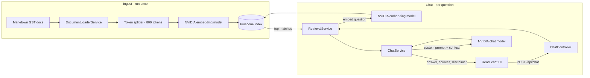

# GST Sutra

**A RAG chatbot that answers Indian GST questions for small shop owners, using only official GST documents and showing its sources.**

GST Sutra is built with Spring Boot 4, Spring AI, Pinecone, and NVIDIA-hosted models, with a React frontend. It answers only from the Markdown knowledge base in the backend, and each answer lists the document and section it came from.

> **Unofficial demo.** GST Sutra is not affiliated with the Government of India. Its answers are general information, not tax advice. Check the official sources before you act on them.

**Live:** Frontend at https://gst-sutra.smitroy.com · API at https://api.gst-sutra.smitroy.com

---

## Why this exists

GST rules change often, and the official documents are long and written for tax professionals. A shop owner who wants to know the rate for packaged snacks, or whether they must register, should be able to ask a plain question and get a short answer with a reference. GST Sutra is a small, focused demo of that idea, and of building a grounded RAG system with Spring AI.

## Features

- **Grounded answers.** The model is told to answer only from the retrieved GST context. If the context doesn't contain the answer, the bot says so.
- **Source citations.** Each answer lists the file and section it was drawn from, with links to official pages where the document provides them.
- **Learn section.** Short pages on the CGST Act, IGST Act, CGST Rules, registration thresholds, the Composition Scheme, and GST rates, plus links to official news.
- **Rotating GST facts.** A ticker shows one verified fact every 10 seconds while the answer loads, with the source file named.
- **Disclaimers on every answer.** Each response reminds the user to consult a GST professional.

## Architecture



The backend has no database. Pinecone is the only storage, and the source documents are bundled in the application.

## Tech stack

| Layer | Technology |
|---|---|
| Backend | Java 21, Spring Boot 4.1, Spring Web MVC, Spring Validation, Lombok |
| AI framework | Spring AI 2.0 (OpenAI-compatible client, Markdown document reader, vector store advisor) |
| Models | NVIDIA-hosted chat and embedding models via OpenAI-compatible API |
| Vector database | Pinecone (serverless index) |
| Frontend | React 19, Vite, React Router, react-markdown, remark-gfm |
| Deployment | Docker on Oracle Cloud VM (backend), Vercel (frontend), GitHub Actions (backend CI/CD) |

## Project structure

```
GST-Sutra/
├── backend/
│   ├── Dockerfile
│   ├── pom.xml
│   └── src/
│       ├── main/java/com/smit/GST_Sutra/
│       │   ├── config/         CORS configuration
│       │   ├── controller/     ChatController, IngestController
│       │   ├── dto/            ChatRequest, ChatResponse, SourceInfo
│       │   ├── exception/      GlobalExceptionHandler
│       │   └── service/        DocumentLoaderService, IngestionService,
│       │                       RetrievalService, ChatService
│       ├── main/resources/
│       │   ├── application.yml
│       │   └── docs/           GST knowledge base (Markdown)
│       └── test/               Unit and integration tests
├── frontend/
│   ├── src/
│   │   ├── components/         Chat, facts ticker, learn panel, footer
│   │   ├── data/               Facts, learn cards, learn content
│   │   └── api/                chatApi.js
│   └── vercel.json
└── .github/workflows/
    └── deploy-backend.yml      Build image, copy to VM, restart container
```

## The knowledge base

The backend's `src/main/resources/docs/` folder holds five Markdown files:

| File | Covers |
|---|---|
| `gst-rates.md` | Rate slabs, exempt goods, HSN lookup, rates for common shop items |
| `registration.md` | Turnover thresholds, compulsory registration, documents, timelines |
| `composition-scheme.md` | Eligibility, rates, limits, conditions |
| `filing-deadlines.md` | GSTR-1, GSTR-3B, CMP-08, GSTR-4, late fees |
| `invoicing-basics.md` | Tax invoices, Rule 46 fields, Bill of Supply |

Each file lists its primary sources and a `last_verified` date in its front matter, and each factual statement cites a document, section, and URL. Facts marked "Not verified" in the files are excluded from the chatbot's answers. GST rules change, so check the `last_verified` date before relying on a file.

## How it works

**Ingestion** (`POST /api/ingest`, run once)
1. `DocumentLoaderService` reads each Markdown file and attaches the filename and headings as metadata.
2. `IngestionService` splits the documents into 800-token chunks.
3. Each chunk is embedded with the NVIDIA embedding model and stored in Pinecone.

**Chat** (`POST /api/chat`)
1. `RetrievalService` embeds the question and fetches the closest chunks from Pinecone.
2. `ChatService` sends the chunks and the question to the chat model with a strict system prompt.
3. The response includes the answer, the sources parsed from the chunks, and the disclaimer.

If no chunks match, the bot returns a "not available in the provided documents" message without calling the chat model.

## API

### `POST /api/chat`

Request:
```json
{ "question": "What is the GST rate on packaged namkeen?" }
```

Response:
```json
{
  "answer": "...",
  "sources": [
    { "fileName": "gst-rates.md", "heading": "...", "title": "...", "url": "https://..." }
  ],
  "disclaimer": "This answer is for general information only. ..."
}
```

- Questions must not be blank and must be 500 characters or fewer.
- Errors return `{ "error", "message" }` with a 400 or 500 status.

### `POST /api/ingest`

Loads the Markdown files into Pinecone. This is a development endpoint. Run it once per index, because running it again stores duplicate chunks. Protect or remove it before any public deployment.

## Getting started

### Prerequisites
- Java 21
- Maven (or the included `mvnw` wrapper)
- Node.js 20 or newer
- An NVIDIA API key (for chat and embedding models)
- A Pinecone account and an index

### 1. Create the Pinecone index

The current configuration uses an embedding model that outputs 2048 dimensions, so create the index with:

- **Name:** `gst-sutra-vectors`
- **Dimension:** `2048` (must match the embedding model's output)
- **Metric:** `cosine`

Namespace used by the app: `gst-docs`.

### 2. Set environment variables

Create `backend/.env` (ignored by git) or set these in your IDE run configuration:

```bash
NVIDIA_API_KEY=your_nvidia_key
PINECONE_API_KEY=your_pinecone_key
```

Never commit real keys.

### 3. Run the backend

```bash
cd backend
./mvnw spring-boot:run
```

The API starts on `http://localhost:8080`.

### 4. Ingest the documents (once)

```bash
curl -X POST http://localhost:8080/api/ingest
```

Check Pinecone for vectors in the `gst-docs` namespace.

### 5. Ask a question

```bash
curl -X POST http://localhost:8080/api/chat \
  -H "Content-Type: application/json" \
  -d '{"question":"Do I need GST registration if my turnover is Rs. 25 lakh?"}'
```

### 6. Run the frontend

```bash
cd frontend
npm install
echo "VITE_API_URL=http://localhost:8080" > .env
npm run dev
```

Open http://localhost:5173. The backend allows this origin through CORS.

## Configuration

Key settings in `backend/src/main/resources/application.yml`:

| Setting | Purpose |
|---|---|
| `spring.ai.openai.base-url` | NVIDIA OpenAI-compatible endpoint (include `/v1`) |
| `spring.ai.openai.chat.options.model` | Chat model |
| `spring.ai.openai.embedding.options.model` | Embedding model |
| `spring.ai.openai.embedding.options.dimensions` | Must match the Pinecone index |
| `spring.ai.vectorstore.pinecone.index-name` | Pinecone index name |
| `spring.ai.vectorstore.pinecone.namespace` | Namespace for GST chunks |
| `spring.ai.retry.*` | Retry and backoff for model calls |
| `gst.docs.location` | Location of the Markdown files |
| `gst.chunk.size` | Chunk size setting |

Model IDs and endpoints change over time. Check the current model list before you deploy.

## Deployment

**Backend (Oracle Cloud VM, Docker):**
- The `Dockerfile` builds a JAR with Maven and runs it on a Temurin 21 JRE.
- The GitHub Actions workflow (`deploy-backend.yml`) runs on pushes to `main` that change `backend/**`. It builds the image, copies it to the VM over SSH, and restarts the container with `/opt/gst-sutra/backend.env`.
- The container listens on `127.0.0.1:8080`, so a reverse proxy handles public traffic.
- Required GitHub secrets: `VM_HOST`, `VM_USER`, `VM_SSH_KEY`.

**Frontend (Vercel):**
- Set the root directory to `frontend`. `vercel.json` defines the build and SPA rewrites.
- Set `VITE_API_URL` to the public API URL.

**CORS:** `CorsConfig` allows `http://localhost:5173` and `https://gst-sutra.smitroy.com`. Add any new frontend origin there.

## Testing

```bash
cd backend
./mvnw test
```

The test suite includes unit tests for retrieval and integration tests that call the live embedding and vector services, so they need valid keys in the environment.

## Limitations

- No authentication, chat history, or streaming.
- The knowledge base is a fixed set of five Markdown files. Answers are only as current as those files.
- Source extraction depends on the `[Source: title, url]` citations in the documents.
- The ingest endpoint is open. Protect it before public use.
- Model names and provider APIs can change, so the app may need configuration updates over time.

## Roadmap

- Add a filename check to ingestion so re-ingesting doesn't duplicate chunks.
- Protect the ingest endpoint with an admin key.
- Add an evaluation set of questions with expected sources.
- Add more verified topics: e-way bills, Input Tax Credit, refunds.

## Disclaimer

GST Sutra is an independent educational project. It is not affiliated with, endorsed by, or connected to the Government of India, the GST Council, or the GST Network. It does not provide legal or tax advice.

## Author

**Smit Roy** · [GitHub](https://github.com/smitroy4)